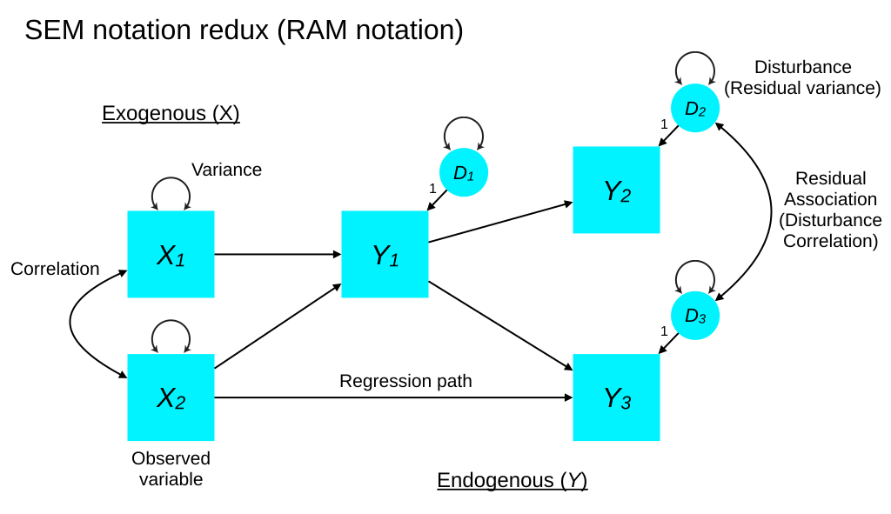
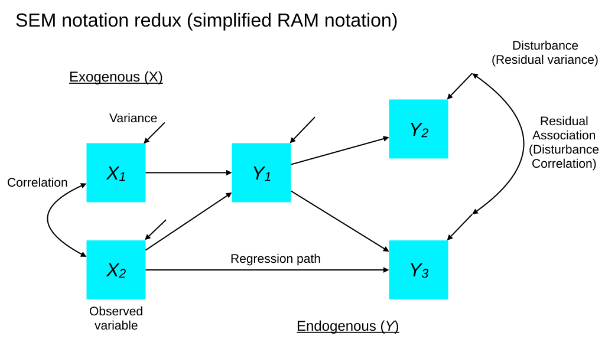
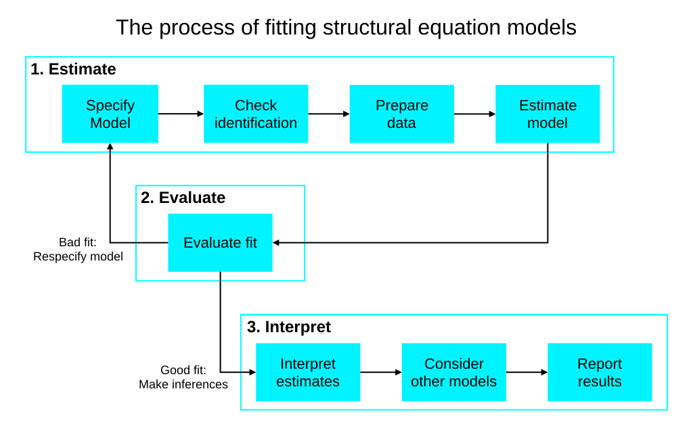



```{r}
#| label: "setup"
#| include: false
library(knitr)
library(tidyverse)
library(lavaan)
library(semPlot)
library(DiagrammeR)
knitr::opts_chunk$set(echo = TRUE) #print code by default
options(digits=3)
set.seed(15092)
```


# Purpose of SEM

Conceptually, the goal of structural equation modeling (SEM) is to test whether a theoretically motivated model of the covariance among variables provides a good approximation of the data.

More specifically, we are trying to test how well a parsimonious model (composed of measurement and/or structural components) reproduces the observed covariance matrix. Formally, we are seeking to develop a model whose *model-implied covariance matrix* approaches the *sample (observed) covariance matrix*.

$$
\mathbf{S_{XX}} \approx \boldsymbol{\Sigma}(\hat{\boldsymbol{\theta}})
$$
In the case where we have positive degrees of freedom (overidentified model), $\boldsymbol{\Sigma}(\hat{\boldsymbol{\theta}})$ is an approximation of $\mathbf{S_{XX}}$. Because we have more equations (observed variances and covariances) than unknowns (free parameters), no set of parameter values will generally reproduce $\mathbf{S_{XX}}$ exactly. This is a *feature*, not a bug --- we are hoping to identify a parsimonious model whose unique optimal parameter estimates $\hat{\boldsymbol{\theta}}$ best fit the observed data.

Thus, there will always be some approximation error. One can think of this as the multivariate extension of residuals in the linear regression case: $Y - \hat{Y}$. More specifically, as in ANOVA and regression, we can decompose sources of error into deviations from the 'true' covariance matrix of the variables in the population, $\mathbf{\Sigma}$.

Let's get technical for a moment. The population covariance matrix $\mathbf{\Sigma}$ does not depend on estimates of each cell derived from a specific sample, nor does it depend on parameters from a statistical model. If we could observe the population covariance matrix and a plausible, but imperfect, SEM at the true population parameters, we could also derive a model-implied covariance matrix for the population, $\boldsymbol{\Sigma}(\boldsymbol{\theta})$. The extent to which this model approximates the true population covariance matrix quantifies the error of approximation (i.e., does the model recover the covariance structure of the population):

$$
\textrm{Error}_\textrm{approximation} = \boldsymbol{\Sigma} - \boldsymbol{\Sigma}(\boldsymbol{\theta})
$$

We, however, only have a sample of the population on which to test our model. Thus, our model-implied covariance matrix is based on parameters estimated in the sample, $\hat{\boldsymbol{\theta}}$. Thus, a second source of error in SEM is not how well the model could do in the ideal case (i.e., the population), but how well we can estimate population parameters using our sample.

$$
\textrm{Error}_\textrm{estimation} = \boldsymbol{\Sigma}(\boldsymbol{\theta}) - \boldsymbol{\Sigma}(\hat{\boldsymbol{\theta}})
$$

::: {.callout-note}
## Approximation error vs. estimation error
- **Approximation error** ($\boldsymbol{\Sigma} - \boldsymbol{\Sigma}(\boldsymbol{\theta})$) reflects structural misspecification of the model in the population; increasing sample size $N$ does *not* remove it.
- **Estimation error** ($\boldsymbol{\Sigma}(\boldsymbol{\theta}) - \boldsymbol{\Sigma}(\hat{\boldsymbol{\theta}})$) reflects sampling variability in estimating $\boldsymbol{\theta}$ from finite data; it shrinks toward zero as $N$ grows.
:::

In SEM, we will be minimizing the overall discrepancy by searching for parameters $\hat{\boldsymbol{\theta}}$ that maximize the sample likelihood function:

$$
\mathcal{L}(\boldsymbol{\theta} \mid \mathbf{S_{XX}}, \textrm{model})
$$

More descriptively, we evaluate the likelihood of candidate parameter values $\boldsymbol{\theta}$ given the observed covariance matrix $\mathbf{S_{XX}}$ and a specific model (some variant of SEM), which corresponds to the probability density of observing $\mathbf{S_{XX}}$ under $\boldsymbol{\theta}$. We cover the underpinnings of this approach in [Maximum Likelihood Estimation](../04_latent_variables_estimation/maximum_likelihood.qmd), but for now, the key idea is that we have a quantitative basis for ascertaining how good our parameter estimates are. If we identify better parameter estimates, the sample likelihood *increases*, indicating that we are getting closer to the observed covariance matrix.

# Types of parameters

## Free

Free parameters are estimated by the model according to the data. That is, they are estimated by fitting the model to the data to achieve a criterion (e.g., OLS in regression).

## Fixed

Fixed parameters are constants, often specified by you (the scientist).

## Constrained

Constrained parameters specify a required relationship between two or more parameters. For example, $a = 2b$, or requiring that two factor loadings be equal. One can also specify that a parameter must fall within a certain range (e.g., $-2$ to $2$) using inequality constraints.

### Equality constraint

When two free parameters are constrained to be equal, then in effect we are only estimating one free parameter. For example, if we posit that the association between self anger and partner sadness during an interaction should be equal for both members of a couple (*p1* and *p2*), then we can estimate just one parameter ($b$ in the path model below).


```{r}
grViz("digraph regression {
graph [ bgcolor=transparent]

forcelabels=true; splines=line;

node [shape = box, fontcolor=gray25 color=gray80]

node [fontname='Helvetica']
{rank=same; Anger_M [label=<Anger<sub>p1</sub>>]; node [fillcolor=gray90 style=filled] Sadness_M [label=<Sadness<sub>p1</sub>>]; }

{rank=same; Anger_F [label=<Anger<sub>p2</sub>>]; node [fillcolor=gray90 style=filled] Sadness_F [label=<Sadness<sub>p2</sub>>]; }

edge [color=gray50 style=filled]
{ rank=same; Anger_M -> Sadness_M [label='a'] }
{ rank=same; Anger_F -> Sadness_F [label='a'] }
Anger_M -> Sadness_F [label='b']
Anger_F -> Sadness_M [label='b']
}")
```

# Types of variables

## Endogenous

Endogenous variables have at least one cause (predictor) in the model. That is, their values *depend* on something that is modeled. In standard regression, we might call them *dependent* variables. In a path diagram, endogenous variables have at least one incoming arrow.

### Disturbance

Each endogenous variable has a *disturbance* that represents unexplained variability due to unmeasured exogenous causes. As a result, disturbances are unobserved random (latent) variables rather than observed sample residuals ($y_i - \hat{y}_i$). In an observed-variable path model, disturbances reflect a combination of measurement error and unmeasured causes.

## Exogenous

Exogenous variables are not caused (predicted) by other variables in the model.

# Types of relationships among variables

## Direct effect

Direct effects represent the relationship between a predictor and an outcome (endogenous variable) that are not mediated by any other variable (Bollen, 1987). This could mean either *ignoring* potential mediating variables (i.e., they are not included in the model) or including them. In causal mediation analysis, the natural direct effect represents the effect of an independent variable (e.g., treatment) on an outcome (e.g., depression) while holding a candidate mediator (e.g., ruminative thoughts) constant at the level that would occur under a fixed reference level of the treatment (e.g., $M(0)$ or $M(1)$; Imai et al., 2010).

```{r}
#| fig-height: 3
#| fig-width: 8
grViz("digraph regression {
graph [rankdir = LR bgcolor=transparent]

forcelabels=true;

node [shape = box, fontcolor=gray25 color=gray80]

node [fontname='Helvetica']
X;

node [fillcolor=gray90 style=filled]
Y;

edge [color=gray50 style=filled]
X -> Y [label='Direct']
}")
```

### Direct effect in the presence of a mediator

```{r}
#| fig-height: 3.5
#| fig-width: 8
grViz("digraph regression {
graph [rankdir = LR bgcolor=transparent]

forcelabels=true;

node [shape = box, fontcolor=gray25 color=gray80]

node [fontname='Helvetica']
X; M;

node [fillcolor=gray90 style=filled]
Y;

edge [color=gray50 style=filled]
X -> Y [label='Direct']
X -> M [label='Indirect (a)']
M -> Y [label='Indirect (b)']
}")
```

## Indirect effect

Indirect effects represent the effect of a predictor on an outcome via one or more intervening (mediating) variables. Thus, the idea is that the outcome is related to a predictor *because* the predictor influences a mediating variable, which in turn influences the outcome.

### Single mediator

```{r}
#| fig-height: 3.5
#| fig-width: 8
grViz("digraph regression {
graph [rankdir = LR bgcolor=transparent]

forcelabels=true;

node [shape = box, fontcolor=gray25 color=gray80]

node [fontname='Helvetica']
X; M;

node [fillcolor=gray90 style=filled]
Y;

edge [color=gray50 style=filled]
X -> Y [label='Direct']
X -> M [label='Indirect (a)']
M -> Y [label='Indirect (b)']
}")
```

### Multiple mediators

```{r}
#| fig-height: 3
#| fig-width: 8
grViz("digraph regression {
graph [rankdir = LR, bgcolor=transparent, layout=dot]

forcelabels=true;

node [shape = box, fontcolor=gray25 color=gray80]

node [fontname='Helvetica']
X; M1; M2;

node [fillcolor=gray90 style=filled]
Y;

edge [color=gray50 style=filled]
X -> Y [xlabel='e']
X -> M1 [label='a']
M1 -> M2 [label='b']
M2 -> Y [label='c']
M1 -> Y [label='d']
}")
```

In a multiple mediation model, one considers the direct effect ($e$) of a predictor $X$ on a criterion $Y$ after accounting for all mediating variables (here, $M1$ and $M2$).

### Specific indirect effect

Multiple mediation also exposes the new concept of specific indirect effects, which summarize the association between a predictor, $X$, and outcome, $Y$, via one or more *specific* intervening pathways. For example, in the above model, we could measure how much of the relationship between $X$ and $Y$ is transmitted via the $X \rightarrow M1 \rightarrow Y$ path, which would be $a \cdot d$.

### Total indirect effect

The total indirect effect is the sum of all indirect pathways between $X$ and $Y$ (i.e., excluding the $X \rightarrow Y$ path).

### Testing indirect effects

The [mediation and moderation notes](../12_mediation_moderation/mediation_moderation.qmd) develop these ideas further. But when we think about the *magnitude* of an indirect effect, it is best to conceptualize it as a *product* of the pathways between the predictor and outcome. Thus, the specific indirect effect of $X$ on $Y$ via the $X \rightarrow M1 \rightarrow M2 \rightarrow Y$ pathway is the product of the corresponding parameter estimates $a \cdot b \cdot c$.

## Total effect

The total effect of $X$ on $Y$ is the sum of the direct effect and the *total* indirect effects. Note: Thus, the total indirect effect can also be conceptualized as the total effect minus the direct effect.

## Common cause

Two variables can be related to each other because they were caused by a common third variable. For example, $Y_1$ and $Y_2$ may be related because they were both influenced by $X$.

```{r}
grViz("digraph regression {
graph [rankdir = LR bgcolor=transparent]

forcelabels=true;

node [shape = box, fontcolor=gray25 color=gray80]

node [fontname='Helvetica']
X;

node [fillcolor=gray90 style=filled]
Y1; Y2;

edge [color=gray50 style=filled]
X -> Y1;
X -> Y2;

}")
```

## Common outcome

As we'll return to when we discuss causality, a variable can also be a common outcome of two (potentially independent) causes. In the causality world, this is also called an *inverted fork* (or *collider*).

```{r}
grViz("
digraph g {
  # a 'graph' statement
  graph [overlap = true, fontsize = 12]

  # observed variables use rectangles (boxes)
  node [shape = box, fontname = Arial, width=1, height=0.6]
  Flu Lyme Fever

  edge [fontname = Arial]
  Flu -> Fever
  Lyme -> Fever
}")
```

# Review of SEM Notation

For a full worked example of RAM and LISREL notation, see [SEM Notation](../02_sem_basics/sem_notation.qmd). Below is a quick reference for the notation we use in path analysis and full SEMs.

## RAM (graphical) notation



## Simplified RAM notation

For simplicity, we can remove the distinction between exogenous variances and endogenous disturbances using a single inward-pointing arrow to denote both constructs:



## LISREL all-y notation

In this class, we will typically adopt the 'all-y' LISREL notation in which the parameter matrices do not distinguish between exogenous and endogenous variables.

- $\mathbf{y}_i$: A vector of observed values for the *i*th individual.
- $\boldsymbol{\eta}_i$: A vector of latent variable values for the *i*th individual. Estimates of these values are factor scores.
- $\boldsymbol{\Lambda}_y$ or $\lambda_{1,1}$: Factor loadings of the observed variables $\mathbf{Y}$ onto factors $\boldsymbol{\eta}$. Also conceptualized as regression slopes (observed regressed on latent). Note that if expressed by specific subscripts (e.g., $\lambda_{1,1}$), the first subscript is the observed variable ($y_{1...j}$) and the second subscript is the factor ($\eta_{1...k}$). Thus, $\mathbf{\Lambda}$ is $j \times k$ in size.
- $\boldsymbol{\Theta}_\varepsilon$: The covariance matrix of observed-variable residuals, with residual variances on the diagonal. The vector $\boldsymbol{\varepsilon}_i$ contains the individual residuals.
- $\boldsymbol{\zeta}_i$: vector of disturbances in endogenous variables (i.e., residual variability due to unmeasured causes).
- $\boldsymbol{\Psi}$: covariance matrix of latent disturbances (and exogenous latent variables). For endogenous latent variables, the diagonal entries are disturbance (residual) variances rather than total variances.
- $\mathbf{B}$: The matrix of regression coefficients.

## lavaan notation for SEM matrices

The `lavaan` package largely uses LISREL notation in naming and structuring the underlying matrices in a SEM. More specifically, it uses the 'all-Y' notation in which there are not separate matrices for endogenous and exogenous variables (see Kline Appendix 10.A). Thus, for example, all structural regression coefficients are represented in the $\mathbf{B}$ matrix, rather than separating it into exogenous ($\mathbf{\Gamma}$) and endogenous ($\mathbf{B}$) predictors. The parameter specification and notation of `lavaan` can be seen by examining the output of the `inspect` function on a fitted model object.

### Political democracy example

Here is a model from Bollen's 1989 SEM book (p. 332). The dataset contains various measures of political democracy and industrialization in developing countries. Notice that the syntax uses parameter labels (`a*`, `b*`, `c*`) to constrain corresponding 1960 and 1965 indicators of political democracy to have equal factor loadings across time. Calling `inspect(fit)` (which defaults to `what = "free"`) prints integer parameter indices (`0` = fixed, positive integers = free parameter positions; equality constraints are enforced separately via the parameter labels) in `lavaan`'s four LISREL all-y matrices (`lambda`, `theta`, `psi`, `beta`).

- y1: Expert ratings of the freedom of the press in 1960
- y2: The freedom of political opposition in 1960
- y3: The fairness of elections in 1960
- y4: The effectiveness of the elected legislature in 1960
- y5: Expert ratings of the freedom of the press in 1965
- y6: The freedom of political opposition in 1965
- y7: The fairness of elections in 1965
- y8: The effectiveness of the elected legislature in 1965
- x1: The gross national product (GNP) per capita in 1960
- x2: The inanimate energy consumption per capita in 1960
- x3: The percentage of the labor force in industry in 1960

```{r}
## The industrialization and Political Democracy Example
## Bollen (1989), page 332
model <- '
  # latent variable definitions
     ind60 =~ x1 + x2 + x3
     dem60 =~ y1 + a*y2 + b*y3 + c*y4
     dem65 =~ y5 + a*y6 + b*y7 + c*y8

  # regressions
    dem60 ~ ind60
    dem65 ~ ind60 + dem60

  # residual correlations
    y1 ~~ y5
    y2 ~~ y4 + y6
    y3 ~~ y7
    y4 ~~ y8
    y6 ~~ y8
'

fit <- sem(model, data = PoliticalDemocracy)
semPaths(fit)
inspect(fit)
```

### Common factor model

These parameter matrices can be used to express specific variants of SEM in matrix form. For example, the common factor model is a form of linear regression in which observed variables $\mathbf{Y}$ are regressed on latent factors $\boldsymbol{\eta}$ with factor loadings $\mathbf{\Lambda}_y$ quantifying the magnitude of the relationship:

$$
\mathbf{y}_i = \boldsymbol{\nu} + \boldsymbol{\Lambda}_{y} \boldsymbol{\eta}_i + \boldsymbol{\varepsilon}_i
$$


# Steps in developing and testing SEMs

The typical set of steps in developing and testing SEMs is provided in the figure below:



# Model identification

## Number of observations

The number of 'observations' in SEM refers to the number of unique values in the covariance matrix. We've seen this equation before:

$$ p = \frac{k(k+1)}{2} $$

where $p$ is the number of variance-covariance parameters and $k$ is the number of variables. The number of observations provides crucial information about how complex a SEM we can test given the number of observed variables.

The number of free parameters in a SEM is denoted $q$, and the degrees of freedom for the overall model is the difference between $p$ and $q$:

$$ df_\textrm{M} = p - q $$

Thus, as we've discussed, the goal is to develop a parsimonious model with fewer free parameters than observations (covariance values). If two models fit the data equally well, the model with more degrees of freedom should be preferred as more parsimonious. We will return to this issue when considering relative model evidence.

## Overidentified

A model with $df_\textrm{M} > 0$ is called *overidentified*, meaning that there are more equations than unknowns. Consequently, no parameter vector will generally reproduce the sample covariance matrix exactly. Given a model parameterization (i.e., what matrices are included and what the free parameters are), the goal is to find the unique set of parameter estimates that minimizes discrepancy according to a fit criterion—in SEM, usually the sample likelihood function mentioned above.

## Underidentified

A model with $df_\textrm{M} < 0$ is called *underidentified*, meaning that there are too many unknown parameters to solve for and no way to solve the equations.

$$ a + b = 6 $$

There are an infinite number of values for $a$ and $b$ that would solve this equation.

## Just-identified

A model with zero degrees of freedom that also satisfies the identification conditions is called *just-identified* and reproduces the sample moments exactly. There is a single set of parameter estimates in a just-identified model that reproduces the covariance matrix, though there are many alternative just-identified models one could fit to the same dataset, all fitting equally well and making hypothesis testing of global fit impossible.

::: {.callout-important}
## Positive degrees of freedom are necessary, not sufficient
Counting degrees of freedom ($df_\textrm{M} \ge 0$, the *t-rule*) is **necessary** but **not sufficient** to establish identification. A model with $df_\textrm{M} \ge 0$ can still be locally or empirically underidentified—for example, if one region of the model has more free parameters than local information while another region is over-constrained, or if a feedback loop lacks instrumental variables.
:::

## Aside: Nonrecursive Models

[From Michael Clark](https://m-clark.github.io/sem/graphical-models.html#path-analysis)

Recursive models have strictly unidirectional causal effects and uncorrelated disturbances. A model is considered nonrecursive if it contains a reciprocal relationship (feedback loop) or a *bow* pattern (a direct path combined with a correlated disturbance between the same pair of variables); note that *bow-free* correlated disturbances—such as the correlated indicator residuals in Bollen's Political Democracy model above—can still be identified even though some authors classify any correlated disturbance as nonrecursive. Nonrecursive models with feedback loops or bows are often difficult to identify because there may not be enough unique information in the covariance matrix to estimate all paths separately.

A classic example of a nonrecursive relationship is marital satisfaction: the more satisfied one partner is, the more satisfied the other, and vice versa (at least that's the theory). This can be represented by a simple model (below).


```{r}
#| label: "nonRecursive_old"
#| eval: false
#| echo: false
#| fig-align: "center"
#| fig-height: 2
#| dev: "svg"
WifeSatisfaction = rnorm(100)
HusbandSatisfaction = rnorm(100)
WifeEdu = rnorm(100)
HusbandEdu = rnorm(100)
FamIncome = rnorm(100)

model1 = '
WifeSatisfaction ~ .25*HusbandSatisfaction
HusbandSatisfaction ~ .5*WifeSatisfaction

WifeSatisfaction ~~ HusbandSatisfaction
HusbandSatisfaction ~~ 1*HusbandSatisfaction
WifeSatisfaction ~~ 1*WifeSatisfaction
'

m1 = sem(model1, data=data.frame(WifeSatisfaction, HusbandSatisfaction))
semPlot::semPaths(m1, layout='tree2', style='lisrel',rotation=2, covAtResiduals=F,
                  # whatLabels = 'par',
                  sizeMan=10, edge.label.cex=1.5, color='#ff5500', borders=F,
                  label.color='#ffffff') # simply doesn't plot nonrecursive models correctly
```

```{r}
#| label: "nonrecursive"
#| echo: false
#| cache: false
         DiagrammeR::grViz('nonrecursive.gv', width=500, height=250)
```

Such models are notoriously difficult to specify in terms of *identification*, which we will talk more about later.  For now, we can simply say the above model would not even be estimated as there are more parameters to estimate (two paths, two variances) than there is information in the data (two variances and one covariance).

# Path analysis

## Notation

Path analysis is largely an extension of linear regression with observed variables to the multivariate case. That is, in path analysis, there are typically multiple predictors and multiple outcome variables. Furthermore, chained relationships (e.g., $X \rightarrow M \rightarrow Y$) lead to the possibility of indirect effects and the potential for a given variable to be endogenous (i.e., its values depend on other variables in the model) and to predict another endogenous variable.

Conceptually, we can think of path analysis in terms of a set of simultaneous regression equations. For example, Kline (Appendix 6.A) writes a two-outcome (here *nonrecursive*, because $Y_1$ and $Y_2$ reciprocally influence each other with exogenous predictors $X_1$ and $X_2$) system as:

$$
\begin{align}
Y_1 &= \gamma_{11} X_1 + \beta_{12} Y_2 + \zeta_1 \\
Y_2 &= \gamma_{22} X_2 + \beta_{21} Y_1 + \zeta_2
\end{align}
$$
We could re-express this in matrix form as:

$$
\mathbf{Y} = \mathbf{\Gamma X} + \mathbf{B Y} + \boldsymbol{\zeta}
$$
(In a *recursive* path model with no feedback loops, one of $\beta_{12}$ or $\beta_{21}$ is zero, and $\mathbf{B}$ can be arranged to be strictly lower-triangular.)

In addition, there may be associations among exogenous variables (in $\boldsymbol{\Phi}$) or endogenous disturbances (in $\boldsymbol{\Psi}$).

$\boldsymbol{\Phi}$ contains variances and covariances among measured exogenous variables.

$$
\boldsymbol{\Phi}=\begin{bmatrix}
\phi_{11} & \\
\phi_{21} & \phi_{22}
\end{bmatrix}
$$

$\boldsymbol{\Psi}$ contains variances and covariances among the disturbances for endogenous variables.

$$
\boldsymbol{\Psi}=\begin{bmatrix}
\psi_{11} & \\
\psi_{21} & \psi_{22}
\end{bmatrix}
$$

Recall that in LISREL all-y notation, we eliminate the need to distinguish between exogenous and endogenous variables in the formal matrix representation, though these are nevertheless very important conceptual distinctions.

# Tracing rule

[Adapted from Michael Clark](https://m-clark.github.io/sem/graphical-models.html#path-analysis)

In a recursive model, *implied correlations* between two variables, $A$ and $B$, can be found using Wright's *tracing rules*. The bivariate correlation between two variables in a standardized path model (where all variables have unit variance) is equal to the sum of the products of standardized path coefficients along all valid routes between them. Specifically, one *traces* all valid routes between $A$ and $B$ that:

1. **do not visit the same variable more than once** (no loops),
2. **do not enter a variable through an arrowhead and leave through an arrowhead** (i.e., never trace through a collider $\rightarrow V \leftarrow$; once moving forward with arrows, never reverse to move backward against arrows), and
3. **traverse at most one double-headed curved arrow** (undirected covariance) per route.

If **unstandardized** path coefficients are used to compute an implied *covariance*, each valid tracing product is multiplied by the single variance of the turning-point/source variable (where the route changes from backward to forward, or the starting exogenous variable for a purely directed route)—or, if the tracing crosses a double-headed curved arrow, by that single covariance instead of a variance.

Consider a set of correlated variables, $A$, $B$, and $C$ with a model seen in the below diagram. We are interested in identifying the implied correlation between $A$ and $C$ by decomposing the relationship into its different components and using tracing rules.

```{r}
#| label: "traceCoefsInit"
#| echo: false
mu <- rep(0, 3)
Sigma <- tribble(
  ~a, ~b, ~c,
  1, 0.2, 0.3,
  0.2, 1, 0.7,
  0.3, 0.7, 1
)

abc <- MASS::mvrnorm(1000, mu = mu, Sigma = Sigma, empirical = TRUE)
colnames(abc) <- LETTERS[1:3]
psych::describe(abc)[, c("n", "mean", "sd")]
```
<!-- something about semplot is screwy too, so don't cache it either -->

```{r}
#| label: "traceCoefs"
#| cache: false
cor(abc)

model <- "
  C ~ B + A
  B ~ A
"

pathMod <- sem(model, data = abc)
coef(pathMod)
```

```{r}
#| label: "traceCoefsPlot"
#| echo: false
#| cache: false
semPlot::semPaths(pathMod, whatLabels = 'par', style = 'lisrel',
                  sizeMan = 10,
                  edge.label.cex = 1.25, edge.color = 'gray50',
                  color = '#ff5500',
                  borders = TRUE, border.color = 'gray80', border.width = 2,
                  label.color = '#ffffff', bg = 'transparent')
```

To reproduce the correlation between $A$ and $C$ (which equals the *total effect* of $A$ on $C$ here because $A$ is exogenous with no confounders or curved arrows):

- Corr = $(A \rightarrow C) + (A \rightarrow B) \cdot (B \rightarrow C)$
- Corr = `r paste(round(coef(pathMod)["C~A"],3), '+', round(prod(coef(pathMod)[c("B~A", "C~B")]),3))`
- Corr = `r coef(pathMod)["C~A"] + prod(coef(pathMod)[c("B~A", "C~B")])`

In SEM models, it's important to consider how well our model-implied correlations correspond to the actual observed correlations. For *over-identified* models, the correlations will not be reproduced exactly, and thus can serve as a measure of how well our model fits the data.

In addition, the tracing of paths is important in understanding the *structural causal models* approach of Judea Pearl, of which SEM and the potential outcomes framework are a part.

## Disturbances and their covariance matrix

A disturbance such as $\zeta_i$ is an individual-specific deviation from the value predicted by the structural model. The matrix $\boldsymbol{\Psi}$ describes the variances and covariances of those disturbances across individuals. Thus, a disturbance is a random variable; its variance is a parameter on the diagonal of $\boldsymbol{\Psi}$.
