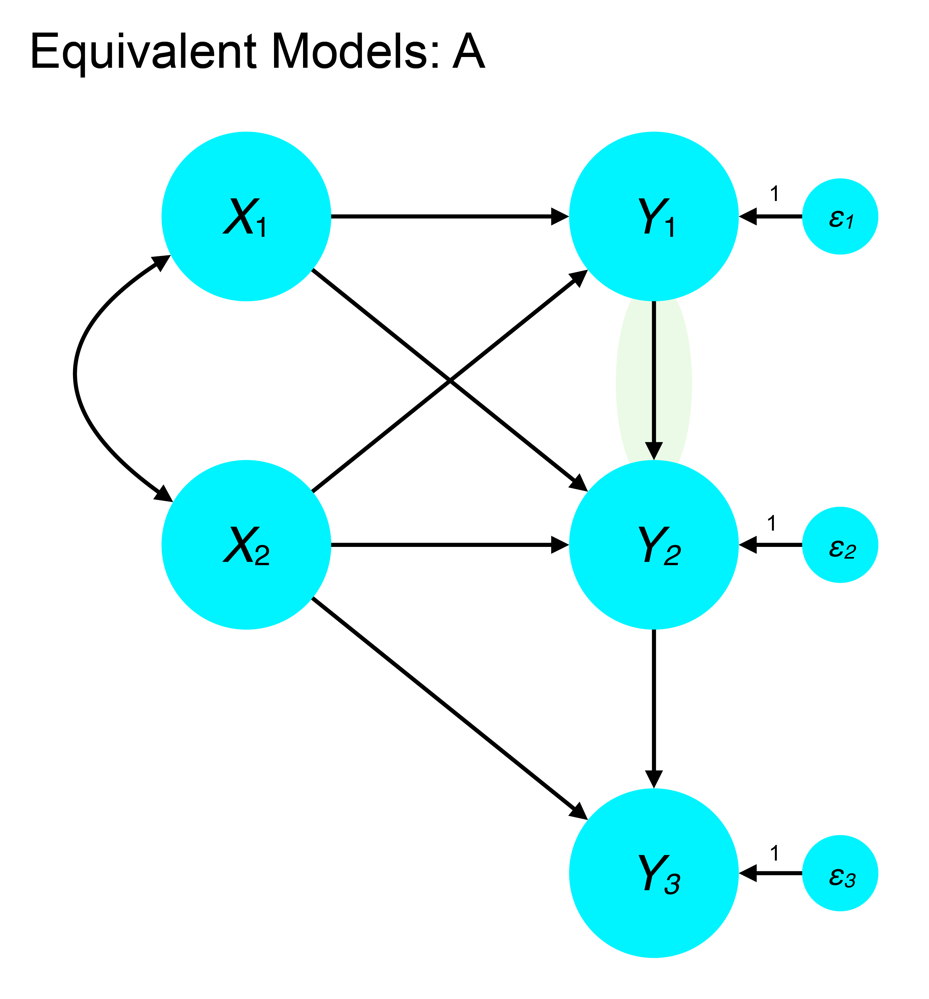
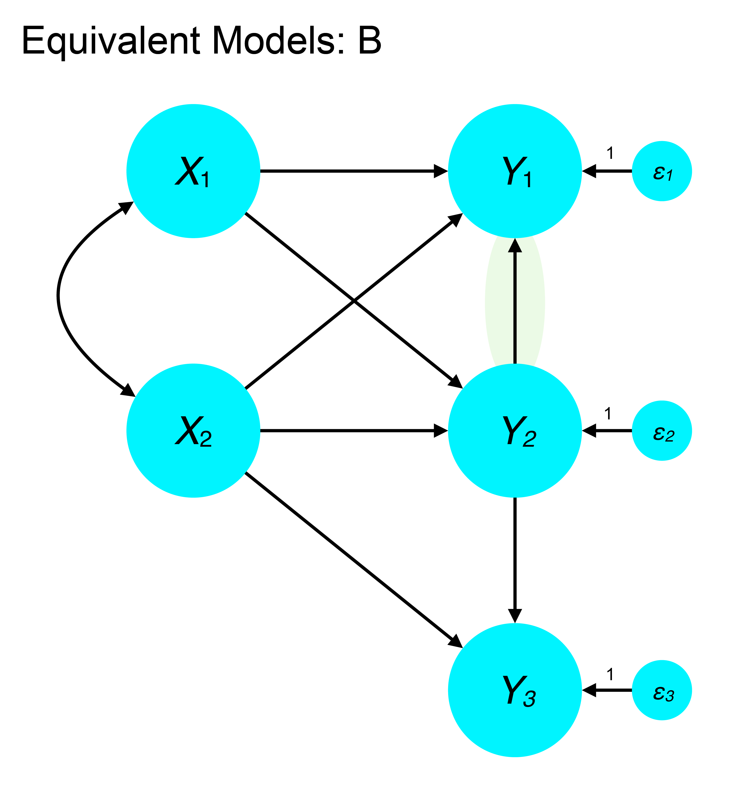
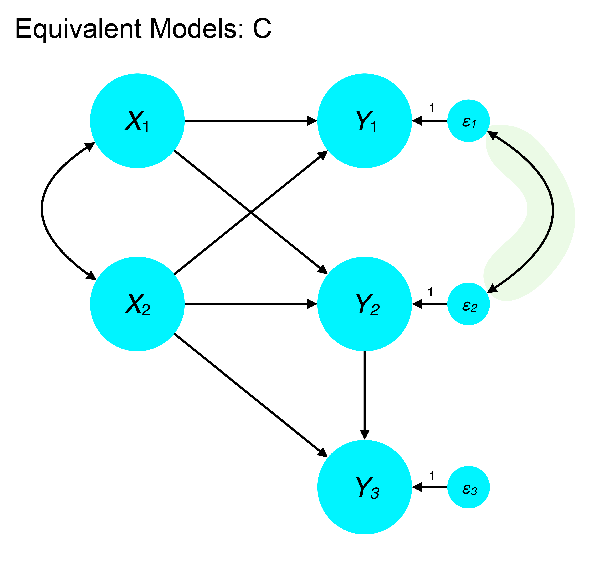
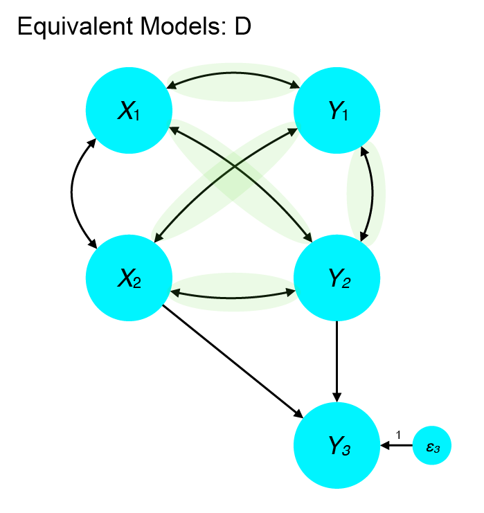
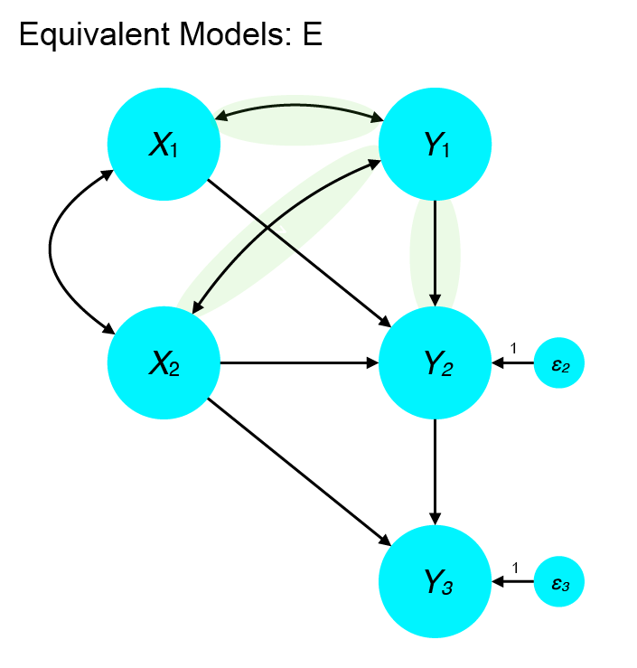
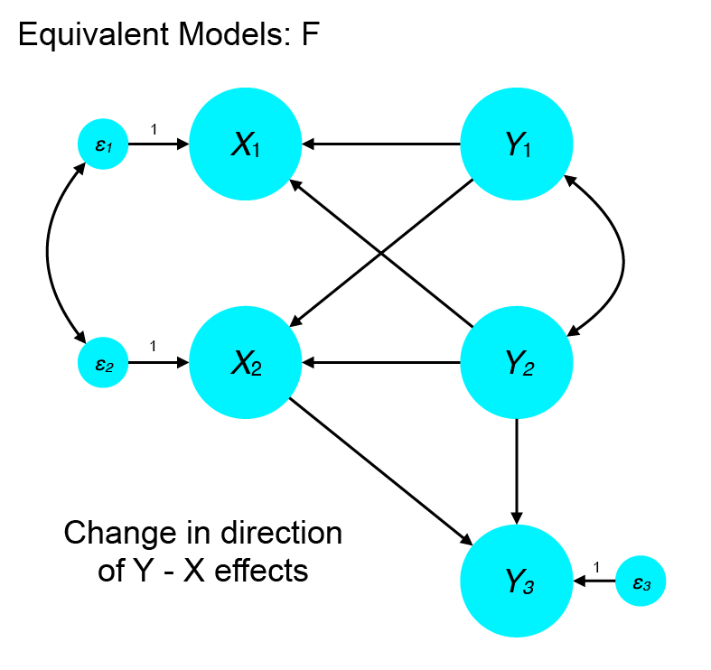
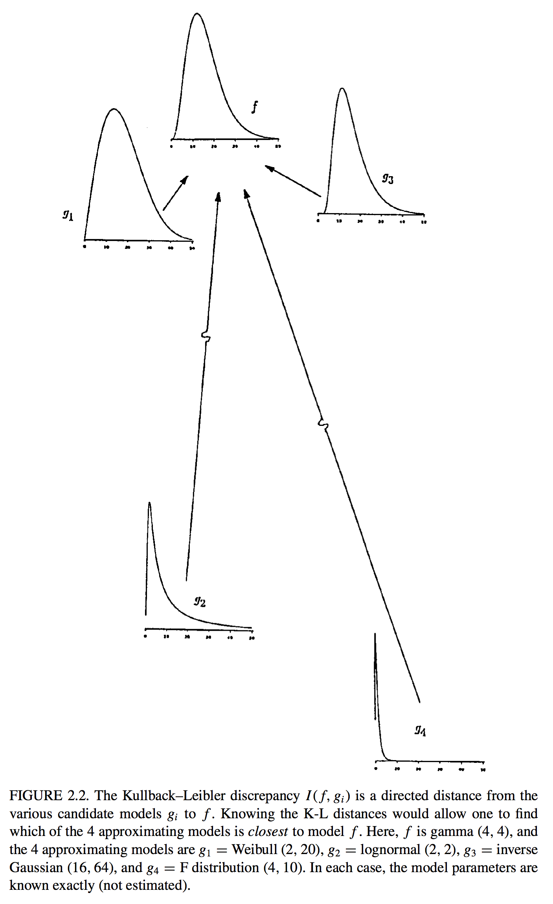



```{r}
#| label: "setup"
#| include: false
library(knitr)
library(MASS)
library(tidyverse)
library(lavaan)
library(semPlot)
library(nonnest2)
library(semTools)
library(AICcmodavg)
knitr::opts_chunk$set(echo = TRUE) #print code by default
options(digits = 3)
set.seed(15092) #to make simulated data the same across computers

#small function to plot all SEM diagrams
semPaths_default <- function(lavObject, sizeMan = 15, ...) {
  require(semPlot)
  semPaths(lavObject, nCharNodes = 0, sizeMan = sizeMan, sizeMan2 = 4, sizeLat = 13, sizeLat2 = 7, ...)
}
```

# Problems with emphasizing global fit

Tomarken and Waller (2003) note the following problems with models that appear to fit well according to global statistics:

1.  There are many equivalent models that fit equally well
2.  There may be several alternative models that could fit better
3.  Important variables may be omitted (that would affect fit)
4.  Fit of lower-order components may be poor
5.  An ill-fitting partition (component) may be masked within a well-fitting overall model
6.  Global stats may be insensitive to particular kinds of misspecification (esp. in mean structure models)
7.  One may make post hoc modifications to the model that reduce the validity and reproducibility of the results.

They also offer the following advice for avoiding overreliance on global fit statistics:

1.  Acknowledge plausible equivalent models and design studies to rule out these alternatives
2.  Compare the fit of a candidate model against nonequivalent alternatives (e.g., one-factor versus three-factor)
3.  Acknowledge potentially important variables that were omitted from the model or not measured. How might these alter the conclusions?
4.  Report and evaluate lower-order model components
5.  Test components of the model to verify fit in each (this can proceed hierarchically)
6.  Design studies with sensitivity to detect non-trivial misspecifications and include measures to flag trivial misspecifications (I think this is quite hard in practice)
7.  Clearly distinguish between a priori models and post hoc modifications, or models generated from a search process.

# Equivalent models

Equivalent models have the same degrees of freedom but specify different relationships among variables. Furthermore, equivalent models fit the data equally well, providing identical fit statistics and sample likelihood. These can pose a problem in SEM when our core conclusions rest on specifying the directionality of a relationship if changing the cause and effect would result in equivalent fit.

In general, directed (causal) relations cannot be inferred from covariance data without strong assumptions about the processes that generated the data. For example, if one variable causes another, the cause must precede the effect in time. Likewise, causal relationships are more plausible if one variable is manipulated experimentally and its effects on dependent variables are measured. Thus, the problem of equivalent models largely points to a limitation of relying on observational techniques and correlational measures.

-  *Observational equivalence*: one model generates every probability distribution (univariate or multivariate) generated by an alternative model. In other words, the models cannot be distinguished because the data they generate is identical.
-  *Covariance equivalence*: every covariance matrix possible under one model could be equally generated by another. This leads to the same residual structure and conditional independence relationships.

## Lee-Hershberger replacing rules for structural models

-  Within a block of variables at the beginning of a structural model that is just identified and has unidirectional relations to subsequent variables (**Rule 1**), *direct effects, correlated disturbances, and equality-constrained reciprocal effects are interchangeable*. That is, we can replace $Y_1 \rightarrow Y_2$ with $Y_1 \leftarrow Y_2$, $Y_2 \leftrightharpoons Y_1$, or $D_1 \leftrightarrow D_2$.

-  At subsequent places in the model where two *endogenous* variables have the same causes and their relations are unidirectional (**Rule 2**), all of the following may be substituted for one another: $Y_1 \rightarrow Y_2$, $Y_1 \leftarrow Y_2$, $Y_2 \leftrightharpoons Y_1$ (equality-constrained), or $D_1 \leftrightarrow D_2$.

In directed acyclic graph (DAG) terms, these rules generate *Markov-equivalent* graphs—graphs with the same skeleton (undirected adjacencies) and the same colliders (v-structures), which therefore imply the exact same conditional independence constraints.

Limitations of replacing rules:

1.  They may not be transitive: reapplying replacing rules from previous applications may not generate additional versions of the model that are all equivalent.
2.  Applying the rules carelessly can generate a new structural model whose conditional independence relationships are not identical (a problem with *d*-separation, as we'll discuss in the causality chapter).

## Examples of equivalent models

From Mulaik (2009). In the first three figures below, $Y_1$ and $Y_2$ share the exact same causes ($X_1$ and $X_2$), so **Rule 2** guarantees that Models A, B, and C are covariance-equivalent. The remaining three figures saturate the source block and apply **Rule 1** to substitute undirected associations or reversed paths without changing global fit.

### $Y_1$ causes $Y_2$ (Model A)
{width=700px}


### $Y_2$ causes $Y_1$ (Model B — Rule 2)
{width=700px}

### $Y_1$ and $Y_2$ have correlated disturbances (Model C — Rule 2)

Note that this model does not include any causal path between $Y_1$ and $Y_2$, which seems like a conceptually distinct position from Models A and B, yet produces identical covariance fit.

{width=700px}

### Saturate relationships among $X_1$, $X_2$, $Y_1$, and $Y_2$ (Model D)

{width=700px}

### Make $X_1 - Y_1$ and $X_2 - Y_1$ relationships undirected (Model E — Rule 1)

{width=700px}

### Change the direction of causality (Model F — Rule 1)

{width=700px}

## What to do?

### After the data are collected

From Hershberger (2006):

1.  Use a criterion for judging model quality that is not based solely on global goodness-of-fit or likelihood. For example, Bozdogan's information complexity criterion (ICOMP) penalizes model misfit relative to parameter-estimate collinearity (complexity of the covariance matrix of parameter estimates), preferring lower ICOMP among equivalent models. In R, ICOMP and related criteria are available via `semTools::moreFitIndices()` (demonstrated below).

2.  Eliminate equivalent models that have problems during estimation such as many iterations, negative variance estimates, or parameters that have to be constrained to avoid improper solutions. This is a heuristic approach.

3.  Combine $R^2$ measures for endogenous variables into a single measure (e.g., mean) and prefer the model with the highest value. This is also heuristic and relatively untested.

4.  Examine extended individual case residuals (EICR). Although the residual covariance matrix is identical among equivalent models, the residuals in terms of predicted versus observed scores on manifest variables are not. Thus, according to Raykov and Penev (2001), a model that minimizes individual case residuals should be preferred over equivalents.

::: {.callout-warning}
## Fit statistics cannot resolve equivalence
No covariance-based fit index or likelihood ratio test can distinguish covariance-equivalent models. Post-hoc heuristics like those above cannot substitute for strong theory, temporal ordering (longitudinal designs), or experimental manipulation.
:::

### Before the data are collected

1.  Try to come up with situations where reversing some paths, even if ancillary, is implausible. Recall that the L-H replacing rules only yield equivalent models when two endogenous variables have the same causes.

Consider this example (we pass `conditional.x = FALSE` throughout so all four models are evaluated on the same full four-variable likelihood):

```{r}
#| fig-height: 4
#| fig-width: 5
m <- '
Happiness ~ 0.3*Money + 0.3*Love
Travel ~ 0.4*Happiness + 0.3*Money
'

d <- simulateData(m, sample.nobs = 500)

# groundtruth
f1.syn <- '
Happiness ~ Money + Love
Travel ~ Happiness + Money
'
f1 <- sem(f1.syn, d, conditional.x = FALSE)
semPaths_default(f1)
```

This model is **not** equivalent to reversing the `Happiness -> Travel` path:

```{r}
#| fig-height: 4
#| fig-width: 5
# not equivalent
f2.syn <- '
Happiness ~ Money + Love + Travel
Travel ~ Money
'
f2 <- sem(f2.syn, d, conditional.x = FALSE)
semPaths_default(f2)
```

Why not? `Love` is not a cause of `Travel` in either model, so `Happiness` and `Travel` do not share the same causes (violating Rule 2).

By contrast, `f3` below **is** equivalent to `f1` by Rule 1: the exogenous block (`Money`, `Love`) is just-identified and has unidirectional effects on downstream variables, so we can replace the undirected covariance `Money ~~ Love` with a directed path `Love ~ Money`. Likewise, `f4` keeps the `{Love, Happiness, Money}` block just-identified (including `Money ~ Happiness + Love`) while preserving the single conditional-independence constraint that `Love` has no direct path to `Travel`, making `f4` equivalent to `f1` and `f3`:

```{r}
#| fig-height: 3
#| fig-width: 5
# equivalent (Rule 1: Money ~~ Love replaced by Love ~ Money)
f3.syn <- '
Love ~ Money
Happiness ~ Money + Love
Travel ~ Happiness + Money
'
f3 <- sem(f3.syn, d, conditional.x = FALSE)
semPaths_default(f3)

# equivalent (complete {Love, Happiness, Money} block; Love still omitted from Travel)
f4.syn <- '
Happiness ~ Love
Money ~ Happiness + Love
Travel ~ Happiness + Money
'
f4 <- sem(f4.syn, d, conditional.x = FALSE)
semPaths_default(f4)
```

Comparing global fit across all four models confirms that `f1`, `f3`, and `f4` have identical $df$ and $\chi^2$, whereas `f2` is nonequivalent:

```{r}
equiv_tbl <- data.frame(
  Model = c("f1 (ground truth)", "f2 (reversed Happiness <- Travel)", "f3 (Rule 1: Love ~ Money)", "f4 (reordered source block)"),
  df = sapply(list(f1, f2, f3, f4), \(x) fitMeasures(x)["df"]),
  chisq = sapply(list(f1, f2, f3, f4), \(x) fitMeasures(x)["chisq"]),
  pvalue = sapply(list(f1, f2, f3, f4), \(x) fitMeasures(x)["pvalue"]),
  Equivalent_to_f1 = c("Reference", "No", "Yes", "Yes")
)
knitr::kable(
  equiv_tbl,
  col.names = c("Model", "df", "Chi-square", "p-value", "Equivalent to f1"),
  digits = c(0, 0, 3, 3, 0),
  row.names = FALSE
)
```


2.  The closer the model is to saturated, the larger the number of equivalent models. When possible, try to test a relatively sparse structural model. More specifically, in saturated *blocks*, there is little information to adjudicate directionality. Thus, it is useful to include structural variables that are thought to be *unrelated* to others.

3.  Models with many paths suffer from many equivalents. Can you test your key hypotheses in models with fewer variables?

4.  Consider including ancillary variables that are not related to the original set in the model. In particular, consider adding antecedents (predictors) of variables in a source block such that they do not have any relationship to the focal (destination) block.

# Are two models nested, non-nested, or equivalent?

When we are considering two or more alternative models, we need to understand their relationships to each other. Models can be *nested*, *non-nested*, or *equivalent*.

Conceptually, model A is nested in model B if model A contains a subset of the parameters in model B. For example, if we remove a correlation between factors in one model, but estimate it in the other, then the restricted model (zero covariance between factors) is nested in the full model. Thus, it is no surprise that the correlated factors model can capture the predictions of the uncorrelated factors model because it can estimate the correlation of zero.

Non-nested models contain parameters that do not represent a part versus whole kind of relationship -- that is, the parameters of one model are not a subset of the other.

And equivalent models, as we've seen above, have the same sample likelihood and degrees of freedom, even though they may have substantively different interpretations (e.g., reversing the direction of a directed path).

Bentler and Satorra (2010) defined a useful nesting and equivalence testing (NET) procedure:

1.  Conduct typical SEM on Model $M1$. Save the $df_{M1}$ and model-implied covariance $\boldsymbol{\Sigma}(\hat{\boldsymbol{\theta}})$.

2.  Conduct a SEM on an alternative model $M2$ using the $\boldsymbol{\Sigma}(\hat{\boldsymbol{\theta}})$ as data (not raw). Save the $\chi^2_{M2}$ and $df_{M2}$.

3.  Compute $d =  df_{M1} - df_{M2}$ and set a small criterion, $\epsilon$, on $\chi^2$ for equivalence (e.g., .001)

4.  Test for relationship between models:
    +  If $d > 0$ and $\chi^2_{M2} < \epsilon$, then $M1$ is *nested* in $M2$.
    +  If $d = 0$ and $\chi^2_{M2} < \epsilon$, the models are *equivalent*.
    +  If $d < 0$ or $\chi^2_{M2} \geq \epsilon$, then $M1$ is *not* nested in $M2$ (if $d < 0$, reverse the roles of $M1$ and $M2$ to check whether $M2$ is nested in $M1$).

The primary idea is that when there are more degrees of freedom in $M1$ than $M2$ *and* the model-implied covariance matrix of $M1$ can be reproduced exactly by $M2$, then $M1$ is nested in $M2$.

# Demo of model comparison

From Brown Ch. 8, Fig 8.1. This is a measure of coping styles administered to 275 college students. There are four first-order latent variables, which reflect different ways of coping with stress: Problem Solving, Cognitive Restructuring, Express Emotions, and Social Support. The authors also anticipated that there are two higher-order factors that account for correlations among the first-order factors: Problem-Focused Coping and Emotion-Focused Coping.

## First-order CFA

```{r}
rawdat <- '
1.00
0.78  1.00
0.80  0.77  1.00
0.56  0.51  0.48  1.00
0.52  0.51  0.46  0.78  1.00
0.59  0.51  0.51  0.80  0.79  1.00
0.16  0.15  0.17  0.14  0.18  0.16  1.00
0.19  0.13  0.18  0.14  0.16  0.16  0.81  1.00
0.12  0.17  0.17  0.17  0.20  0.16  0.75  0.80  1.00
0.16  0.13  0.17  0.15  0.16  0.18  0.56  0.52  0.50  1.00
0.16  0.14  0.18  0.15  0.16  0.18  0.51  0.58  0.51  0.81  1.00
0.16  0.15  0.14  0.16  0.16  0.14  0.52  0.57  0.52  0.80  0.79  1.00
'

# standard deviations of variables
sds <- as.numeric(strsplit('1.40  2.10  1.30  2.30  2.40  1.90  2.00  2.90  2.30  3.10  2.20  1.20', '\\s+', perl = TRUE)[[1]])

cormat <- getCov(rawdat)

# this is the covariance matrix to be analyzed
covmat <- lavaan::lav_cor2cov(cormat, sds)

rownames(covmat) <- colnames(covmat) <- c("P1", "P2", "P3", "C1", "C2", "C3", "E1", "E2", "E3", "S1", "S2", "S3")

# to get Vuong test to work as expected, need raw data, not just a covmat
coping_dat <- mvrnorm(n = 275, mu = rep(0, 12), Sigma = covmat, empirical = TRUE)

bmodel <- '
ProbSol =~ P1 + P2 + P3
CogRest =~ C1 + C2 + C3
ExpEmo =~ E1 + E2 + E3
SocSupp =~ S1 + S2 + S3

# explicitly name factor correlations
ProbSol ~~ CogRest
ProbSol ~~ ExpEmo
ProbSol ~~ SocSupp
CogRest ~~ ExpEmo
CogRest ~~ SocSupp
ExpEmo ~~ SocSupp
'

l1fac_m <- sem(bmodel, data = coping_dat)
semPaths_default(l1fac_m, sizeMan = 7)
```

## Second-order CFA

What about a model with a higher-order factor structure: Problem-Focused (`PFCope`) versus Emotion-Focused (`EFCope`) coping? Note that even though each second-order factor has only two first-order indicators, the higher-order structure is identified ($df = 49$, one more than the first-order model's $df = 48$) because `PFCope` and `EFCope` are correlated: the four first-order factors contribute $10$ latent moments ($4$ variances and $6$ covariances), and the higher-order structure estimates $9$ parameters ($2$ free second-order loadings, $2$ second-order variances, $1$ second-order covariance, and $4$ first-order disturbances), yielding $1$ overidentifying structural degree of freedom.

```{r}
hcfa <- '
ProbSol =~ P1 + P2 + P3
CogRest =~ C1 + C2 + C3
ExpEmo =~ E1 + E2 + E3
SocSupp =~ S1 + S2 + S3

PFCope =~ ProbSol + CogRest
EFCope =~ ExpEmo + SocSupp
'

hcfa_m <- sem(hcfa, data = coping_dat)
semPaths_default(hcfa_m, sizeMan = 7)
```

Comparing global fit and the key factor-level parameters side by side:

```{r}
fit_idx <- c("npar", "chisq", "df", "pvalue", "cfi", "tli", "rmsea", "srmr", "aic", "bic")
fit_tbl <- as.data.frame(rbind(
  "First-order CFA (saturated factor covs)" = fitMeasures(l1fac_m, fit_idx),
  "Second-order CFA (PFCope / EFCope)" = fitMeasures(hcfa_m, fit_idx)
))
fit_fmt <- data.frame(
  npar = sprintf("%.0f", fit_tbl$npar),
  chisq = sprintf("%.2f", fit_tbl$chisq),
  df = sprintf("%.0f", fit_tbl$df),
  pvalue = sprintf("%.3f", fit_tbl$pvalue),
  cfi = sprintf("%.3f", fit_tbl$cfi),
  tli = sprintf("%.3f", fit_tbl$tli),
  rmsea = sprintf("%.3f", fit_tbl$rmsea),
  srmr = sprintf("%.3f", fit_tbl$srmr),
  aic = sprintf("%.2f", fit_tbl$aic),
  bic = sprintf("%.2f", fit_tbl$bic),
  row.names = rownames(fit_tbl)
)
knitr::kable(fit_fmt, align = "r")

# Standardized factor correlations in the first-order CFA
subset(
  standardizedSolution(l1fac_m),
  op == "~~" & lhs != rhs & lhs %in% c("ProbSol", "CogRest", "ExpEmo", "SocSupp")
)

# Higher-order loadings and correlation in the second-order CFA
subset(
  standardizedSolution(hcfa_m),
  lhs %in% c("PFCope", "EFCope") & !(op == "~~" & lhs == rhs)
)
```

## Bentler NET approach

We can test whether models are nested, equivalent, or not nested using Bentler's nesting and equivalence testing procedure (NET). As mentioned above, this involves fitting $M_1$ to the observed data, saving its model-implied covariance matrix, and fitting $M_2$ using that matrix as input. If $df_1 - df_2 > 0$ and the $\chi^2$ of $M_2$ is essentially zero (usually $< .001$), then $M_1$ is nested in $M_2$. Note that this is an asymmetric test: $M_1$ may not be nested in $M_2$, while $M_2$ could still be nested in $M_1$.

## Is the first-order CFA nested in the hierarchical factor model?

Following Bentler's steps with the first-order CFA (which has saturated factor covariances) as $M_1$ and the hierarchical CFA as $M_2$:

```{r}
df1 <- fitMeasures(l1fac_m)["df"] # df for first-order CFA (saturated factor covariances)
mimplied_l1fac <- fitted(l1fac_m)$cov # model-implied covariance matrix

# use the first-order model-implied covariance as input to hcfa
hcfa_m_fromcov <- sem(hcfa, sample.cov = mimplied_l1fac, sample.nobs = 275)
df2 <- fitMeasures(hcfa_m_fromcov)["df"]
d <- df1 - df2
cat("df for NET: ", d, "\n")
chi2 <- fitMeasures(hcfa_m_fromcov)["chisq"]
cat("Chi-square for NET test: ", chi2, "\n")
```

We see that the degrees of freedom difference is negative ($-1$). Thus, the first-order CFA (with saturated factor covariances) is not nested in the hierarchical model. This makes sense intuitively: the hierarchical model imposes constraints on the correlations among the four first-order factors, whereas the first-order model estimates all six factor covariances freely.

## Is the hierarchical model nested in the first-order CFA?

We can reverse the NET test (swapping $M_1$ and $M_2$). To test whether the hierarchical CFA ($M_1$) is nested in the first-order CFA ($M_2$), we take the model-implied covariance matrix from the hierarchical CFA and fit the first-order CFA to it:

```{r}
# is the hierarchical CFA nested in the first-order CFA?
df1 <- fitMeasures(hcfa_m)["df"]
mimplied_hcfa <- fitted(hcfa_m)$cov

# use the hierarchical model-implied covariance as input to the first-order model
l1fac_m_fromcov <- sem(bmodel, sample.cov = mimplied_hcfa, sample.nobs = 275)
df2 <- fitMeasures(l1fac_m_fromcov)["df"]
d <- df1 - df2
cat("df for NET: ", d, "\n")
chi2 <- fitMeasures(l1fac_m_fromcov)["chisq"]
cat("Chi-square for NET test: ", chi2, "\n")
```

Here, we see the expected result for a nested model: the $df$ difference is positive ($1$) and the $\chi^2$ of the second model (fit to the model-implied covariance of the first) is essentially $0$. Thus, the hierarchical CFA model is nested in the first-order factor model.

## Conducting NET the easy way

The `semTools` package provides a `net()` function that computes nesting and equivalence tests for all pairs of models passed in (as separate arguments). This package also provides `moreFitIndices()`, which returns additional fit and information criteria including $AIC_c$ (`aic.smallN`; see below for its role in model evidence).

```{r}
# the easy way
semTools::net(l1fac_m, hcfa_m)

mfi <- semTools::moreFitIndices(l1fac_m)
knitr::kable(
  data.frame(Index = names(mfi), Value = formatC(as.numeric(mfi), format = "f", digits = 3)),
  row.names = FALSE
)
```

# Model evidence, K-L distance

"All models are wrong but some are useful" - *George Box*

Having established whether two models are nested, not nested, or equivalent, we can move onto the important consideration of model evidence. In the case of equivalent models, relative evidence cannot be based on global fit given that both models will have the same likelihood and same number of parameters (see above for potential solutions to this problem). But in the case of non-nested and nested models, we would like to be able to make a statement such as, "Model A fits the data significantly better than Model B, *p* < .01," or, "The evidence for Model A is ten times stronger than the evidence for Model B."

## Binary judgments: likelihood ratios and Vuong tests

The first statement concerns a *binary* judgment about model fit -- that is, we are interested in testing the null hypothesis that two models fit the data equally well. We have seen this approach in previous weeks when using the likelihood ratio test (LRT) -- aka the model chi-square difference test. In the LRT approach, we can compare two *nested* models (using the `anova` function in `lavaan`) to test the null hypothesis that the restricted model (with fewer parameters -- the nested model) fits the data equally well. If we reject this null (typically $p < .05$), then we conclude that the nested model fits significantly *worse* than the full model.

In our example above, we learned from NET (and could figure out intuitively) that the models are nested. Does the hierarchical factor model (nested) fit significantly worse than the first-order factor model (full)?

```{r}
lrt_res <- anova(l1fac_m, hcfa_m)
lrt_res
```

No, we do not reject the null, meaning that we conclude that the nested model (hierarchical factors) does not fit significantly worse than the full model (saturated associations among first-order factors), $p = `r round(lrt_res[["Pr(>Chisq)"]][2], 2)`$. Thus, even though the hierarchical factor model has one fewer free parameter (and thus one additional degree of freedom), it does not fit significantly worse. Typically, in this case, we would retain the simpler model given that its fit is not worse.

If we are interested in binary comparisons of *non-nested* models, we can usually use a Vuong test, which tests the null hypothesis that one model fits as well as an alternative. See [Merkle, You, & Preacher (2016)](https://arxiv.org/pdf/1402.6720.pdf) and the corresponding `nonnest2` package in R, which plays well with `lavaan`. `vuongtest()` reports a two-step procedure: first a **variance test** ($\omega^2$) checking whether the two models are distinguishable in the population, followed by a **non-nested likelihood ratio test** (or nested LRT when `nested = TRUE`) checking whether one model fits significantly better. Although we know that our models are nested above, we can apply `vuongtest()` with `nested = TRUE` (for non-nested models, keep the default `nested = FALSE`):

```{r}
vt <- nonnest2::vuongtest(l1fac_m, hcfa_m, nested = TRUE)
vt
```

Here, the binary judgments match the LRT above: the variance test confirms the models are indistinguishable in fit ($\omega^2 = `r sprintf("%.3f", vt$omega)`$, $p = `r sprintf("%.3f", vt$p_omega)`$), and the nested LRT ($p = `r sprintf("%.3f", vt$p_LRT$A)`$) indicates the hierarchical factor model does not fit significantly worse than the first-order model.

## Relative evidence and Kullback-Leibler (K-L) distance

This, however, is a *binary* judgment. What about the evidence in favor of the hierarchical model versus the first-order model? This is a dimensional question and could be framed in terms of the probability that one model is the best in the set. For example, is the evidence in favor of the hierarchical factor model three times greater than the first-order model?

To make judgments about *relative* evidence, we need a measure of how well one model fits compared to another (or many others).

The goal of most statistical modeling is to approximate the key factors that generated our empirical data. The data generation processes are usually complex and largely unknown, so our models will almost always be deficient in many ways. Nevertheless, we may wish to know how close one model is to the unknown truth relative to a comparator model. This is the substance of model selection theory -- i.e., how one selects among models based on relative evidence.

Kullback-Leibler information quantifies the information lost when a simple model, *g* is used to approximate the true model, *f*:

$$
I(f,g) = \int{f(x) \textrm{log} \left( \frac{f(x)}{g(x|\theta)} \right) dx}
$$
This can also be thought of as the distance between our model, *g* and the population (unknown) model, *f*.



In the simplest case, we can think of trying to identify a probability distribution (e.g., Gaussian) that best describes a given empirical sample. Recall from the M-L lecture our attempt to fit a Gaussian distribution using a Gamma distribution. The sample likelihood for the Gamma, even at optimized (fitted) parameters, can never be as close as a Gaussian fit.

*ML Gamma fit*
```{r}
X <- rnorm(5000, mean = 50, sd = sqrt(50))
gfit <- suppressWarnings(fitdistr(X, "gamma"))
gfit$loglik
datafromgam <- rgamma(n = 5000, shape = gfit$estimate["shape"], rate = gfit$estimate["rate"])
```

*ML Gaussian fit*
```{r}
nfit <- suppressWarnings(fitdistr(X, "normal"))
nfit$loglik
datafromgauss <- rnorm(n = 5000, mean = nfit$estimate["mean"], sd = nfit$estimate["sd"])

dens_df <- data.frame(
  model = rep(c("groundtruth", "gamma", "gauss"), each = 5000),
  v = c(X, datafromgam, datafromgauss)
)

ggplot(dens_df, aes(x = v, color = model)) + geom_density()
```

The sample *LL* is an approximation of a K-L distance between a model and 'truth', but read on to AIC below...

In general, we do not know the true model, which means we cannot compute the exact K-L distance. Fortunately, however, we are often interested in *relative* distance -- that is, how much better is model A than model B? In this circumstance, the K-L distance derivation includes two terms: one is based on the expectation under the 'true' model (can't compute that!), the other is based on the *relative* distance between the model and the truth.

Since we can't compute the first term, it means we do not have a measure of *absolute* fit using likelihood-based and K-L methods. But, because we can compute the relative distance, we can also compute the relative distance *between* two or more models. As a result, we can compare *relative evidence* across a set of candidate models. All may be bad, or all may be good, by some absolute criterion, but we can ascertain which is relatively best. Global fit criteria in SEM often give some information about the absolute fit (esp. residual-based methods). Likelihood methods (K-L distance) are more about relative evidence.

K-L distances are on a true ratio scale (i.e., a meaningful zero point and equal interval spacing). As a result, *differences* in distances can be compared, and a zero K-L difference implies identical relative fit. Note that while the *population* K-L divergence $I(f, g)$ is a fixed property of $f$ and $g$ that does not depend on sample size, the *sample* log-likelihood discrepancy—and therefore $\Delta\text{AIC}$, which scales approximately with $N \cdot \Delta I(f, g)$—grows larger as sample size increases. This does not change the interpretation of K-L distance; rather, it underscores that discriminating among competing models becomes easier in larger samples.

## Akaike Information Criterion (AIC)

The derivation of the AIC was a major breakthrough in information theory and statistics because it provides a statistical link between K-L distance (a more theoretical notion) and maximum likelihood-based methods.

The AIC provides an approximation of the relative distance of the fitted model and the unknown (true) mechanisms that generated the data. Importantly, it is an *asymptotic* criterion (Burnham and Anderson recommend the small-sample correction $AIC_c$ below whenever $N / k < 40$) and is not meaningful if the models in question are fundamentally misspecified for the data type (e.g., fitting a binary outcome with a continuous Gaussian model).

$$
\textrm{AIC} = -2 \ln (\mathcal{L}(\hat{\boldsymbol{\theta}} \mid \mathbf{y})) + 2k
$$
where $k$ is the number of free parameters, and $\mathcal{L}(\hat{\boldsymbol{\theta}} \mid \mathbf{y})$ is the sample likelihood.

Note that by multiplying the *LL* by $-2$, the criterion is now scaled such that *lower* values are better. By contrast, for *LL*, higher values indicate better fit (greater likelihood of the data given the model).

## Corrected AIC

Because AIC is based on a large-sample derivation (i.e., its statistical properties are ideal as the sample size goes to infinity), it may select overly complex models in smaller samples. This led to the derivation of a variant of AIC, usually denoted $\textrm{AIC}_c$ (Sugiura, 1978), that includes an additional penalty for sample size:

$$
\textrm{AIC}_c = -2 \ln (\mathcal{L}(\hat{\boldsymbol{\theta}} \mid \mathbf{y})) + 2k + \frac{2k(k+1)}{N - k - 1}
$$

When your cases-to-parameters ratio ($N / k$) is below 40 (which it usually is in SEM!), Burnham and Anderson recommend $\textrm{AIC}_c$ over AIC. Strictly speaking, this formula was derived for univariate (single-DV) linear regression rather than multivariate SEM, and there is no universal consensus on whether $\textrm{AIC}_c$ should always replace standard $\textrm{AIC}$ in SEM, though it behaves sensibly as a conservative small-sample correction.

# Comparing relative evidence of candidate SEMs

One of the most important considerations when comparing models is that the set of endogenous variables is *the same* and on the same scale! This is often misunderstood in applied papers and can lead to bizarre circumstances where AICs differ by thousands of points. That's not impossible, but more likely to reflect differences in the likelihood function that render models non-comparable using LL-based methods (incl. AIC/BIC). For example, if you log-transform some of the variables, their contribution to the sample likelihood will be remarkably different, rendering models with and without that transformation incomparable (at least in likelihood terms).

Recall that the sample likelihood is computed on the *endogenous* variables. Thus, if the endogenous set changes (e.g., changing the direction of an arrow), LL methods cannot necessarily be compared. In `lavaan`, this relates to the `conditional.x` option. See `?lavOptions`. If it is `FALSE`, then model-implied statistics, including LL, reflect both exogenous and endogenous variables. This is likely what you'd want in cases where you're testing alternative models with path direction changes that would make an endogenous variable exogenous, or vice versa.

If you're not sure, check the unrestricted (saturated) LL for the two candidate models. If they are not identical, you cannot use AIC/BIC to compare them. You might also check your setting of `conditional.x` in `lavaan`. Fortunately, `lavaan` will usually provide a warning: "WARNING: some models are based on a different set of observed variables." If you see that, *watch out*! Your models are almost definitely not comparable, either in terms of LRT (nested) or AIC/BIC (non-nested) comparisons since both are based on the sample likelihood.

Note that you will come across many "IC" (Information Criterion) measures in SEM and statistics, including the Bayesian Information Criterion (BIC). Virtually all IC-based approaches build on the sample log-likelihood and formalize the *fit–parsimony tradeoff*: we want a model that is as parsimonious as possible while still fitting the data well.

We can always improve fit—that is, sample likelihood—by adding additional free parameters. Even if the parameters are not useful (e.g., adding a predictor whose $p$-value is $.50$), they can only improve (or leave unchanged) the in-sample likelihood, akin to unadjusted $R^2$ in regression. Thus, we do not want to prioritize sample likelihood alone. Instead, we penalize complexity so that adding a weak parameter hurts the IC, whereas deleting a strong parameter worsens the likelihood enough to outweigh the complexity savings.

## Efficiency (AIC) vs. consistency (BIC)

Adapted from Hallquist & Pilkonis (2010):

- **Efficiency (AIC):** AIC is an asymptotically *efficient* criterion for model selection, tending to select the model that minimizes prediction error (relative K-L distance) as sample size increases (Claeskens & Hjort, 2008). It assumes that the true data-generating mechanism is complex (effectively infinite-dimensional) and that no single "true model" exists in the candidate set (Burnham & Anderson, 2002).
- **Consistency (BIC):** By contrast, the **Bayesian Information Criterion** replaces AIC's $2k$ penalty with $k \ln(N)$:
  $$\textrm{BIC} = -2 \ln (\mathcal{L}(\hat{\boldsymbol{\theta}} \mid \mathbf{y})) + k \ln(N)$$
  BIC targets statistical *consistency*—selecting the single "true model" with probability approaching $1$ as $N \rightarrow \infty$ (Yang, 2005). Consistency assumes that (1) a single finite-dimensional true model exists, (2) it is included in the candidate set, and (3) the goal is to recover that exact model rather than minimize out-of-sample prediction error. Because social and behavioral data are complex and candidate sets rarely contain the literal data-generating process, Burnham and Anderson (2002) caution against relying solely on BIC, though comparing AIC, BIC, and sample-size-adjusted BIC (SABIC) is informative in practice.

| Criterion | Complexity penalty | Core property | Assumes true model in set? | Typical behavior |
|---|---|---|---|---|
| **AIC** | $2k$ | Asymptotic efficiency (K-L prediction) | No | Favors richer models when $N$ is large |
| **$\text{AIC}_c$** | $2k + \frac{2k(k+1)}{N - k - 1}$ | Small-sample efficiency | No | Guardrail against overfitting when $N/k < 40$ |
| **BIC** | $k \ln(N)$ | Consistency | Yes | Stronger parsimony penalty (for $N \ge 8$) |
| **SABIC** | $k \ln\!\left(\frac{N+2}{24}\right)$ | Compromise penalty | Yes (asymptotically) | Milder than BIC in moderate samples |

## Comparing models based on AIC or BIC differences

Summarizing extensive simulation work, Burnham and Anderson (2002) offer useful rules-of-thumb for inferring the degree of certainty afforded to a particular model relative to the best fitting model in the set:

-  models within 0–2 points on the AIC also have substantial support
-  models in the 4–7 point range have considerably less support
-  models greater than 10 points apart have almost no support.

Moreover, AIC (or $\textrm{AIC}_c$) values for a set of models can be subtracted from the model with the lowest value ($\Delta_i$), and these difference scores can be transformed into **Akaike weights** ($w_i$) representing the relative evidential weight of each model in the set (Burnham & Anderson, 2002). The important general point is that conclusions drawn from latent variable models benefit from being contextualized in terms of model selection uncertainty and the degree of support for one model over alternatives.

For details on Akaike weights or evidence ratios, see the `AICcmodavg` package and Burnham and Anderson (2002). Briefly, the Akaike weight is the estimated probability that model $i$ is the Kullback-Leibler best model among the set of models $I$ tested.

```{r}
aa <- aictab(list(first_order = l1fac_m, higher_order = hcfa_m))
aa_df <- as.data.frame(aa)
aa_fmt <- data.frame(
  Model = aa_df$Modnames,
  K = sprintf("%.0f", aa_df$K),
  AICc = sprintf("%.2f", aa_df$AICc),
  Delta_AICc = sprintf("%.2f", aa_df$Delta_AICc),
  ModelLik = sprintf("%.2f", aa_df$ModelLik),
  AICcWt = sprintf("%.2f", aa_df$AICcWt),
  LL = sprintf("%.2f", aa_df$LL),
  Cum.Wt = sprintf("%.2f", aa_df$Cum.Wt)
)
knitr::kable(aa_fmt, align = c("l", rep("r", 7)), row.names = FALSE)
```

Returning to our first-order versus hierarchical factor model example, note that `aictab()` reports **$\textrm{AIC}_c$** by default: $\Delta\textrm{AIC}_c = `r round(aa$Delta_AICc[2], 2)`$ (compared to raw $\Delta\textrm{AIC} = `r round(abs(diff(lrt_res$AIC)), 2)`$ in `anova()` above), which falls in the modest-to-weak range of Burnham and Anderson's guidelines. The Akaike weights sum to $1.0$ and indicate that the probability that the hierarchical model is the K-L best model in this two-model set is **`r round(aa$AICcWt[1], 2)`** (`r round(100 * aa$AICcWt[1])`%). A `r round(100 * aa$AICcWt[1])`% probability favors the hierarchical model—and its greater parsimony leans in the same direction—but it is far from definitive, so we should acknowledge genuine model-selection uncertainty.

::: {.callout-important}
## Relative evidence does not guarantee absolute fit
AIC, BIC, and Akaike weights only rank the models *included in the candidate set*. Even a model with an Akaike weight of `0.99` can still fit the data poorly in absolute terms, and there may be an *untested* alternative that captures the data far better. Always evaluate absolute and local fit alongside information criteria.
:::

Finally, we can compute the **evidence ratio** comparing the best model $i$ against an alternative $j$:

$$
\textrm{ER}_{ij} = \frac{w_i}{w_j} = \exp\!\left(\frac{1}{2}\Delta\textrm{AIC}_{c,j}\right)
$$

```{r}
evidence(aa)
```

Here, the ratio of evidence in favor of the higher-order factor model is **`r round(evidence(aa)$Ev.ratio, 2)`×** that of the first-order factor model. Many statisticians prefer evidence ratios (closely related to Bayes factors) of $10$ or higher to make strong claims that one model outperforms another; here, the evidence for the hierarchical model is only *moderately* stronger than for the first-order alternative.
